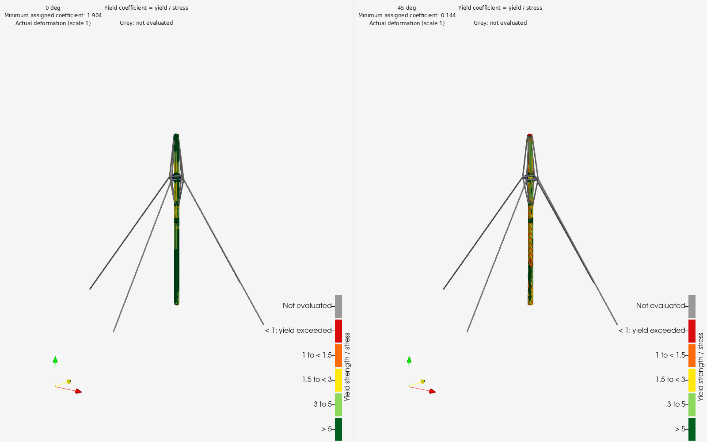
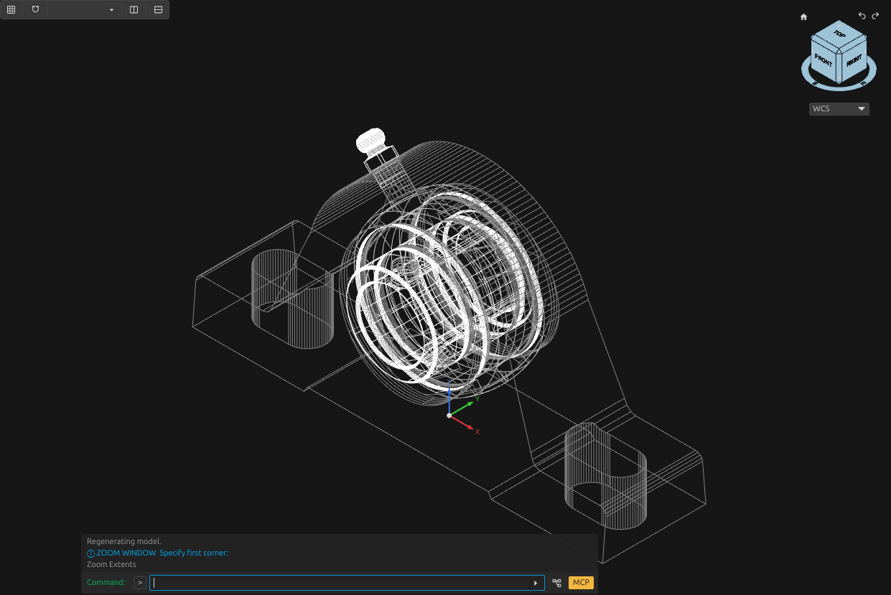
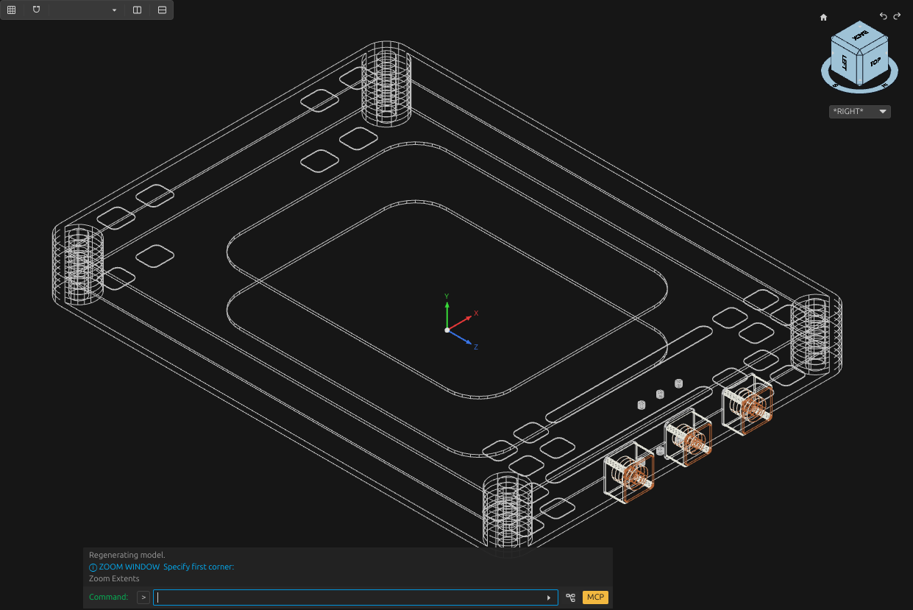
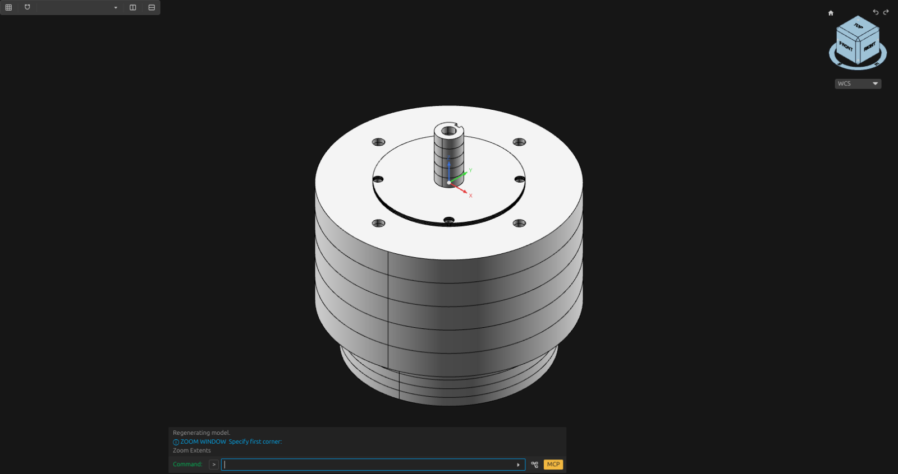
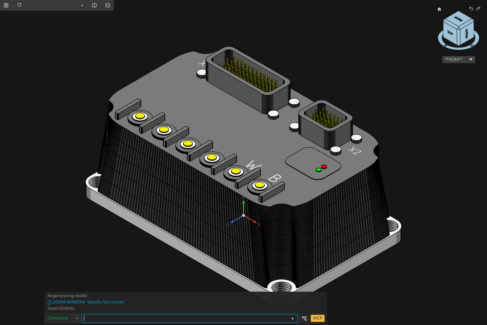
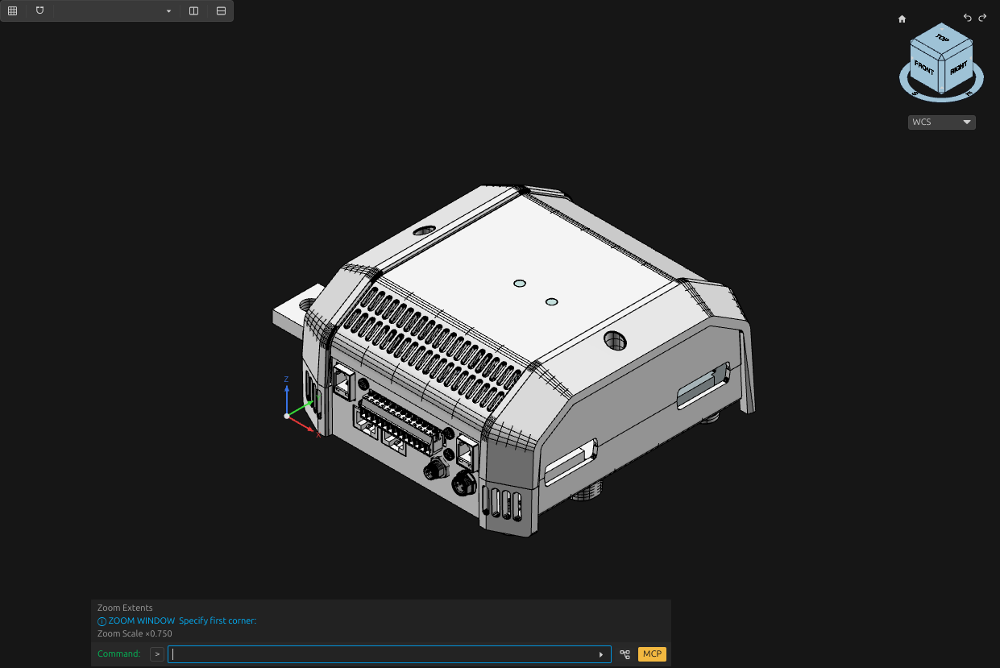

# 3D CAD Modeling

Reusable tools and agent instructions for creating, inspecting and modifying 3D models from descriptions, dimensions, drawings, photographs and existing geometry.

This repo has been used to generate CAD models using the [OpenCADStudio](https://www.opencadstudio.com/) MCP Server.

This is ONGOING WORK. For now, this is the first pre-pre-pre-alpha release. I'll be updating it. Please collaborate, copy it and share it; that is why the license is MIT.

## License

[MIT](LICENSE) for project code and documentation.
All external sources and assets have their own licenses. If I have accidentally left some things without the real check, please contact me and I'll be really pleased to take them out.

## Introduction

If you want to go directly to the examples, check the [Examples](#examples).

I've been working for some time on CAD modeling. The last time I really touched CAD was OpenSCAD (cause I've done software for 20+ years now). The last time I really did something manually in CAD was AutoCAD 2000, some 25+ years ago. I'm too lazy now to learn to use another CAD application, so I decided I'd make AI agents model things for me. I draw on paper as I learnt 3 decades ago, then take pictures and show them to the model. I have my computer running while I sometimes manage things from my phone.

This adventure has not been without problems, blockers, frequent cursing and, of course, AI SLOP that I try to keep to a minimum. After so much work, learning and process improvement, I've started to consolidate all things into a single skills and scripts repository that takes lessons from all those "adventures".

This repo is now a test bed for my recursive self-improving skill (RSI - yes, this is an exaggeration) that I'm using for yet another project to make it better. This skill set is far from done, though I already use it and I'll keep improving it (it is already improving with each new model, and I have 100+ models queued for the automated workflow).

The idea is to share and see if somebody can use it, learn new things and make things faster and simpler.

I'll also share the things that I've been working on in other repositories when I consider they are ready enough, although here you'll get some example screenshots from those projects.

## Project

The project develops a common workflow for mechanical parts, assemblies, buildings and model handoffs to physics simulation.

The main pipeline for a 3D recreation from known things is:

1. Give the agent the part name, drawings, pictures and known measurements.
2. The agent checks whether a matching 3D model already exists.
3. It reads the dimensions and identifies the separate pieces, holes and mounting points.
4. It builds the missing shapes in CAD, or updates the existing model.
5. It measures the result, compares it with the references, saves it and opens it again to check the saved file.
6. It records the result and improves the reusable instructions or code for the next part.

And the main pipeline that I use for NEW things is:

1. I create some hand sketches and descriptions.
2. Send those to an agent.
3. Make the agent spawn a swarm of lightweight research agents to look online for similar things, ideas, concepts and so on.
4. Review those results.
5. Select a few things and ideas, drop others, rephrase, rewrite, restate and review the definitions, references and so on.
6. Get pissed off cause AI changed something without permission and without instruction.
7. Write down all findings and ideas, then commit the changes to Git to keep them.
8. Make AI use the skills for 3D modeling till it blocks (it cannot create things from nothing).
9. Review things and get pissed off again.
10. Iterate.

When I see things are ready enough, I send the automated 3D modeling pipeline to work.

## Repository

1. `docs/` — linked documentation, selected example copies and images.
2. `skills/` — agent task instructions.
3. `scripts/` and `tests/` — reusable helpers and their checks.
4. `research/` — method assessments, workflow definitions and sources.
5. `execution/` — recorded execution reports.

## Examples

### House modeling

This is the first thing I did at this complexity level with AI + drawings + pictures + a lot of iterations. It is a kind of model house that I sent to a 3D model and that was interpreted with a custom three.js library for 3D. Many nice things there. The output was finally done in [IFC](https://en.wikipedia.org/wiki/Industry_Foundation_Classes) and displayed in the browser.

TODO get a house model here?

### Mast physics for a wind generator

I'm working on a wind generator idea, so I started to check how to model a mast support and see how it would behave for the particular geometry I'm trying to get on the top part. Many of the things I did there for the 3D modeling worked out, so I add them here as examples of what the earlier work allowed me to do (with a lot of interaction and effort).

A square mast model and recorded Code_Aster wind cases. [Mast model and simulation pictures](docs/examples/mast.md).




### Mechanical component models

Another current project is about making a remote-controlled 2-wheel tractor, but I do not really have time to work on it in detail, so I'm automating all that I can. This includes a (mostly) automated pipeline that gets available components from standards, pictures and manufacturer details that kind of fit in the base idea I have. I could write a lot, but the idea is to use this project as my 3D automation development test-base.

Selected motor, controller, bearing, battery and BMS examples show source-based construction, component boundaries and saved-model checks. [Mechanical component examples](docs/examples/mechanical_components.md).

#### Bearing unit



#### Battery module



#### Motor interfaces



#### Sumitomo motor controller

Reconstructed housing, power terminals, connector pins, mounting holes and labels.



#### Victron Lynx Smart BMS

Manufacturer CAD assembly with corrected component placements, showing ventilation slots, connectors, fasteners and separate housing parts.



## Installing

I would directly ASK the AI agent you are using to install this and make it available as skills and scripts. That should do the job. But if you want to do it manually, here are some pointers.

### Install an individual skill

Use the skills CLI to install the skill you need:

```sh
npx skills add leomrocha/3d-cad-modeling --skill cad-ocs-engineering
npx skills add leomrocha/3d-cad-modeling --skill cad-drawing-inspection
npx skills add leomrocha/3d-cad-modeling --skill cad-source-intake
```

Each selected skill carries its scripts, instructions, dependency file and license. Set `SKILL_ROOT` to its installed directory containing `SKILL.md`. Give the agent your source files, job location and output paths. Component CAD also needs your running OpenCADStudio session.

For a local copy installation, run from this checkout and select one skill:

```sh
npx skills add . --skill cad-ocs-engineering --copy
```

### Set up the Python helpers

Use Python 3.12 on Linux or macOS. Source intake uses the standard library. Drawing inspection and component CAD use the pinned dependencies included in each package. Create an environment at a location you choose:

```sh
python3 -m venv "$HOME/.venvs/3d-cad-modeling"
. "$HOME/.venvs/3d-cad-modeling/bin/activate"
python -m pip install -r "$SKILL_ROOT/requirements.txt"
python "$SKILL_ROOT/scripts/package_check.py"
```

Component CAD includes the OCS control transport, geometry adapter and save/reopen helpers. With [OpenCADStudio](https://github.com/HakanSeven12/OpenCADStudio) already running, check your selected connection:

```sh
python "$SKILL_ROOT/scripts/package_check.py" --session SESSION
```

The connection check reads OCS state. Its report contains dependency and package results plus the observed document ID and revision. [Package contents and maintenance](docs/skill-packaging.md).

### Use the skills with your agent

1. Give the agent the drawing, pictures or dimensions and describe the model you need.
2. Ask it to read [cad-ocs-engineering](skills/cad-ocs-engineering/SKILL.md) for a component job, [cad-drawing-inspection](skills/cad-drawing-inspection/SKILL.md) for a DXF, or [cad-source-intake](skills/cad-source-intake/SKILL.md) to record the inputs.
3. Specify the component project's input and output locations and the CAD session it should use.
4. Review the resulting model and the changes recorded for that iteration.

### Run a helper directly

For a DXF file named `drawing.dxf`:

```sh
python "$SKILL_ROOT/scripts/dxf_inspect.py" drawing.dxf --output drawing-inventory.json
```

Command-line options for the installed cad-ocs-engineering package:

```sh
python "$SKILL_ROOT/scripts/part_index.py" --help
python "$SKILL_ROOT/scripts/model_inventory.py" --help
python "$SKILL_ROOT/scripts/source_intake.py" --help
```

### Tools

To get a list of all skills and Python helpers, read the [tools page](docs/tools.md). The [skill catalogue](skills/README.md) links the component procedures for source interpretation, construction, assemblies and saved-result checks. The tools page also covers source-bound annular, hexagonal and toroidal geometry and spherical-seat profiles.

### DISCLAIMER

AI use:

* Code and skills are all written with AI. I instruct, reinstruct and review things, then I tell it to modify and update things. But as this is for AI use, I do not correct the phrasing for humans in the parts that are only dedicated to AI.
* The README and main HUMAN-targeted documentation files were sketched by me and written by AI. Then I drop almost everything cause I do not like it and rewrite things, then I send AI agents to fix some small things and details.
* For the AI documentation, I let AI do the writing and try not to get too angry about that cause they are instructions for AI, so ...
