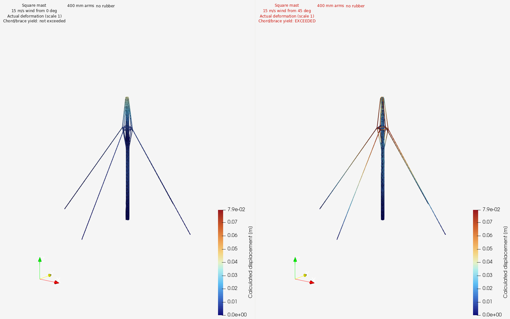

# 3D CAD Modeling

Reusable tools and agent instructions for creating, inspecting and modifying 3D models from descriptions, dimensions, drawings, photographs and existing geometry.

The project develops a common workflow for mechanical parts, assemblies, buildings and model handoffs to physics simulation. Each job connects its geometry to source evidence, units, coordinate frames and recorded checks.

## Examples

### Wind generator: CAD and mast physics

A square mast model and recorded Code_Aster wind cases. [Models, simulation inputs and results](docs/examples/wind-generator.md).

### FERME: component modeling

Selected frame, motor, bearing and battery examples show source-based construction, component boundaries and saved-model checks. [FERME examples](docs/examples/ferme.md).

### Buildings

The proposed building route combines plans, dimensions and component geometry into walls, floors, openings and semantic IFC models. [Building workflow](docs/examples/buildings.md).

## Documentation

1. [Documentation home](docs/README.md) — guide to the pages.
2. [Workflow](docs/workflow.md) — inputs, modeling, checking and handoffs.
3. [Tools](docs/tools.md) — software roles, agent responsibilities and implementation status.
4. [Example gallery](docs/examples/README.md) — wind-generator, FERME and building applications.

## Repository

1. `docs/` — linked documentation, selected example copies and images.
2. `skills/` — agent task instructions.
3. `scripts/` and `tests/` — reusable helpers and their checks.
4. `research/` — method assessments, workflow definitions and sources.
5. `execution/` — recorded execution reports.

## License

[MIT](LICENSE) for project code and documentation. Imported source assets retain their recorded terms and attribution.
