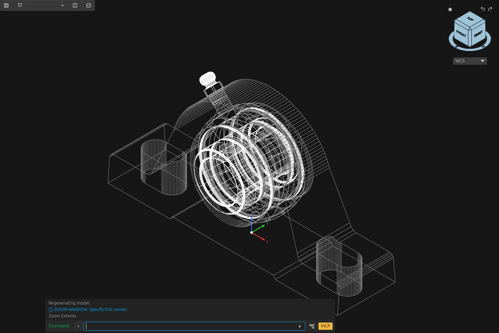

# Examples

[Documentation](../README.md) · [Workflow](../workflow.md)

## Wind generator

[Mast models and physics](wind-generator.md): mast models; 15 m/s wind cases; displacement and yield-comparison plots.

## FERME components

[Selected FERME models](ferme.md): a hollow frame member, motor interfaces, bearing unit and battery module, with source-based geometry and saved-model checks.

## Buildings

[Building workflow](buildings.md): the proposed route from a floor plan and measurements to walls, floors, openings and IFC relationships.
