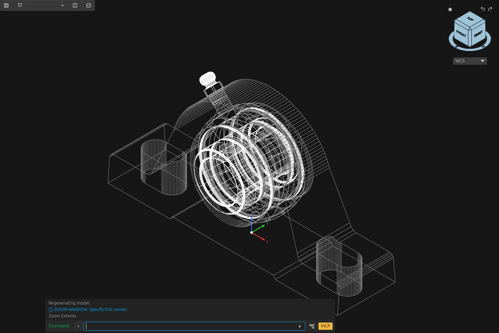
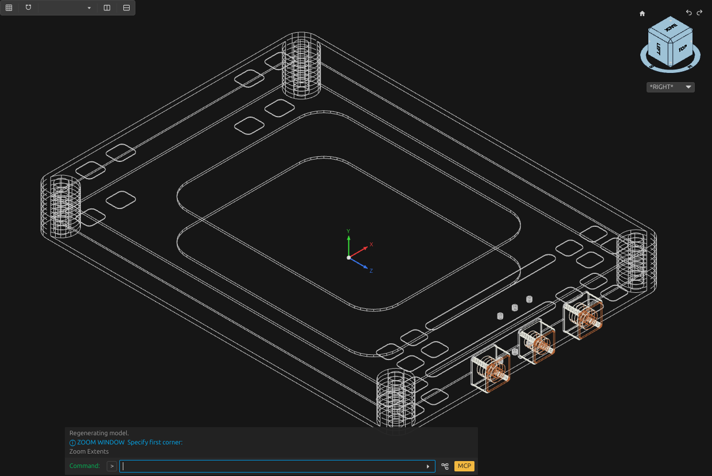
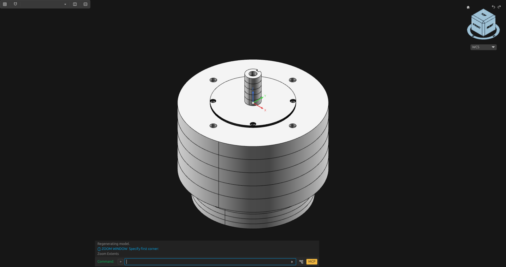
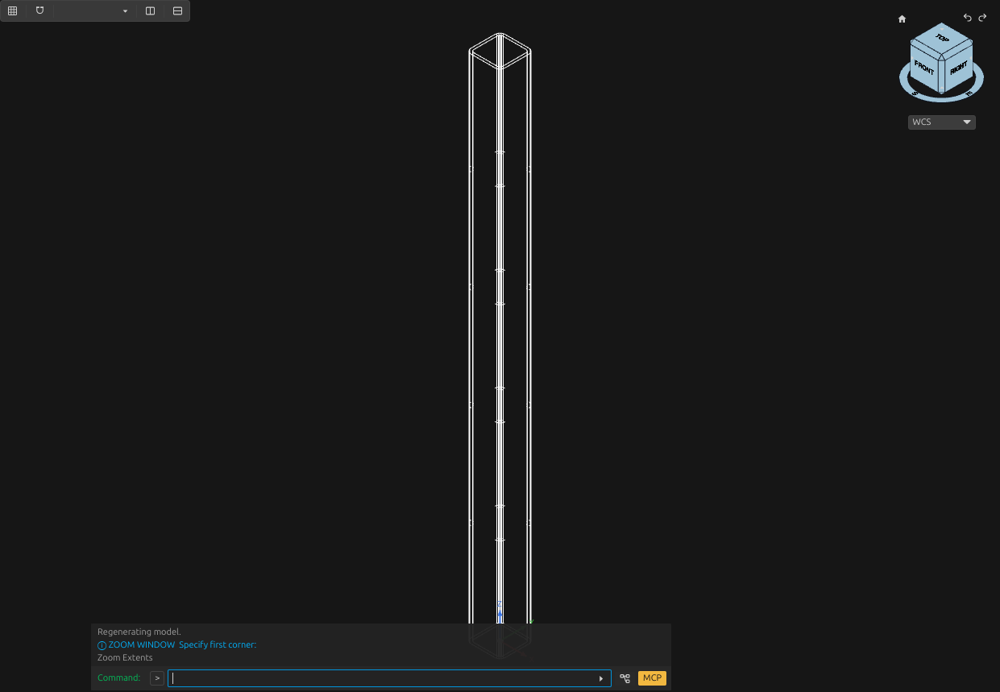

# Mechanical component examples

[Examples](README.md) · [Workflow](../workflow.md) · [Tools](../tools.md)

## Introduction

One of the reasons for the current project is thigns I've been using this project

## Examples

The following examples are fully automated reconstructions from specs, the general pipeline for these component reconstructions is:

TODO HERE SHOW THE STEPS THAT WERE DONE FOR RECONSTRUCTING THESE

These existing OpenCADStudio captures show component geometry used to develop reusable construction and inspection procedures.

## Bearing unit

The SKF SY20TF model keeps the housing, bearing rings, seals, flingers, screws and grease fitting separately identifiable. The retained [component result](files/ferme/bearing-result.json) records 62 passing native checks and passing persistence checks. [Bearing checker](../../scripts/pillow_block.py).

## Battery module

The Nissan Leaf Gen2 module model represents the shells, mounting bores and terminal assemblies. The retained [component result](files/ferme/battery-result.json) records 29 passing native checks and passing persistence checks. [Battery checker](../../scripts/battery_module.py).
## Motor interfaces

The Motenergy ME0907 model represents the source-dimensioned housing, pilot, blind mounting patterns and keyed shaft. This example exercises axial features, mounting-hole patterns and shaft interfaces. [Axial motor helper](../../scripts/axial_motor.py).

## Frame member

The longitudinal rail represents proposed 40 × 40 × 3 mm square tube with a 600 mm cut length. The model uses a hollow rounded section. Its reusable procedure binds section dimensions and length to source-labelled inputs, then checks native and reopened geometry. [Tube helper](../../scripts/rounded_tube.py) · [Construction contract](../reference/operations.md#cad-10).
