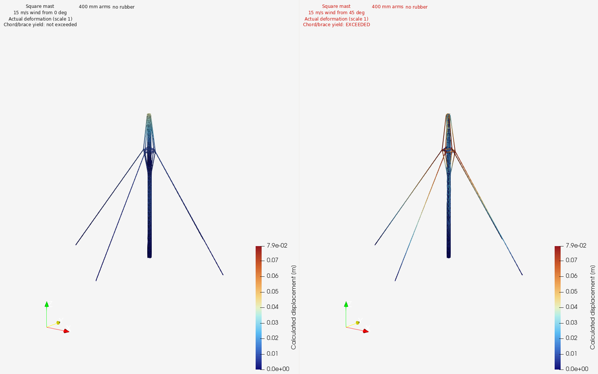
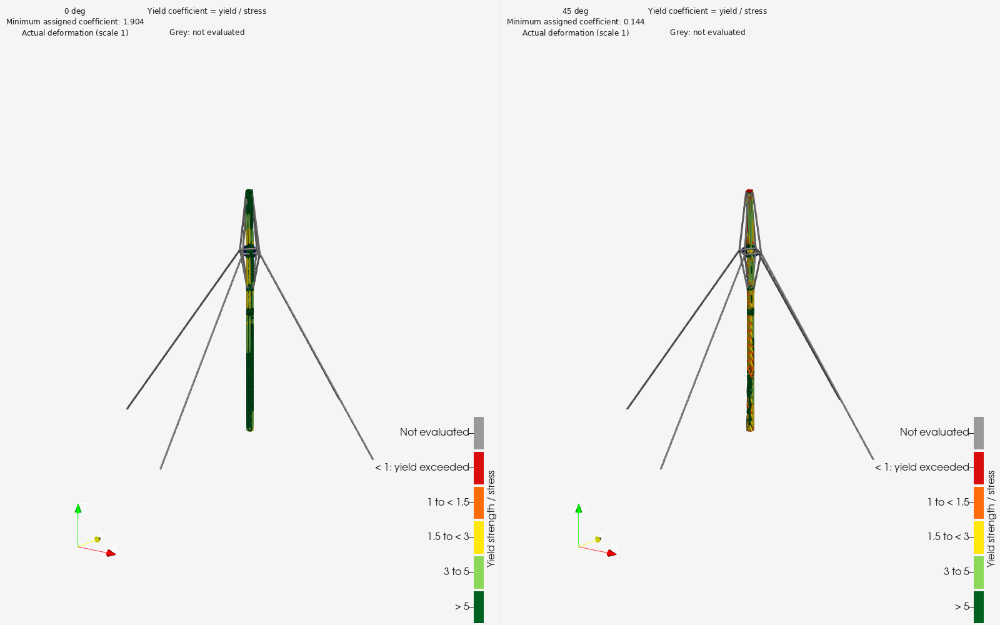

# Mast physics for a wind generator

[Examples](README.md) · [Workflow](../../README.md#project) · [Tools](../tools.md)

I'm working on a wind generator idea, so I started to check how to model a mast support and see how it would behave for the particular geometry I'm trying to get on the top part. Many of the things I did there for the 3D modeling worked out, so I add them here as examples of what the earlier work allowed me to do (with a lot of interaction and effort).

## Example results

The displacement image uses actual deformation scale 1 and colours in metres.

The dimensionless colour coefficient is assigned yield strength divided by calculated stress. Values below 1 identify yield-input exceedance; grey elements are outside that comparison.
