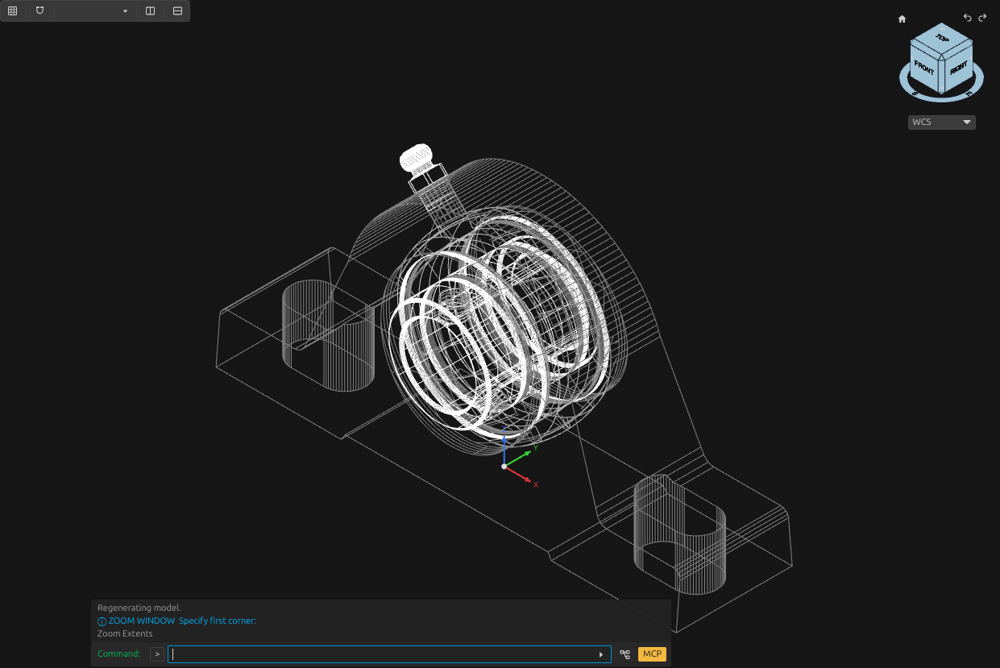
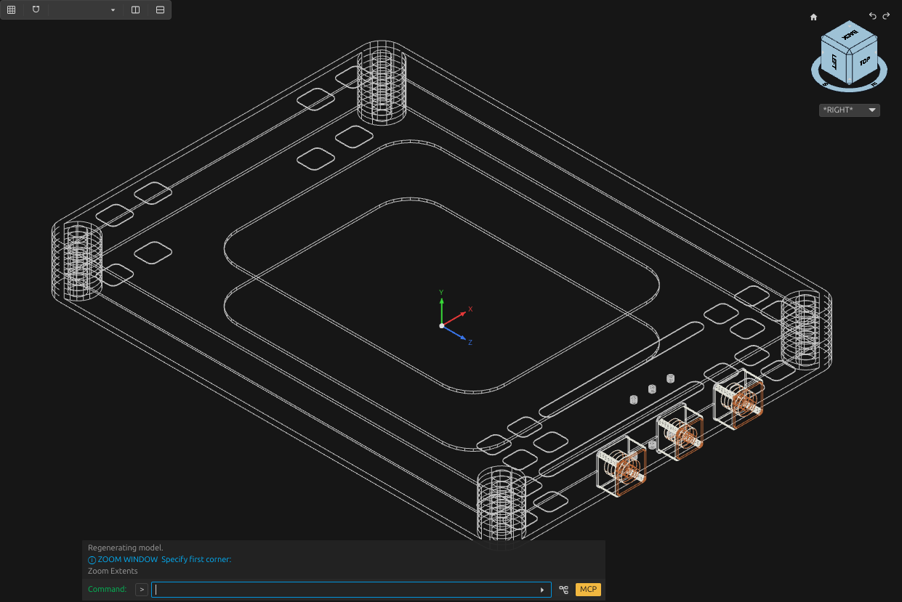
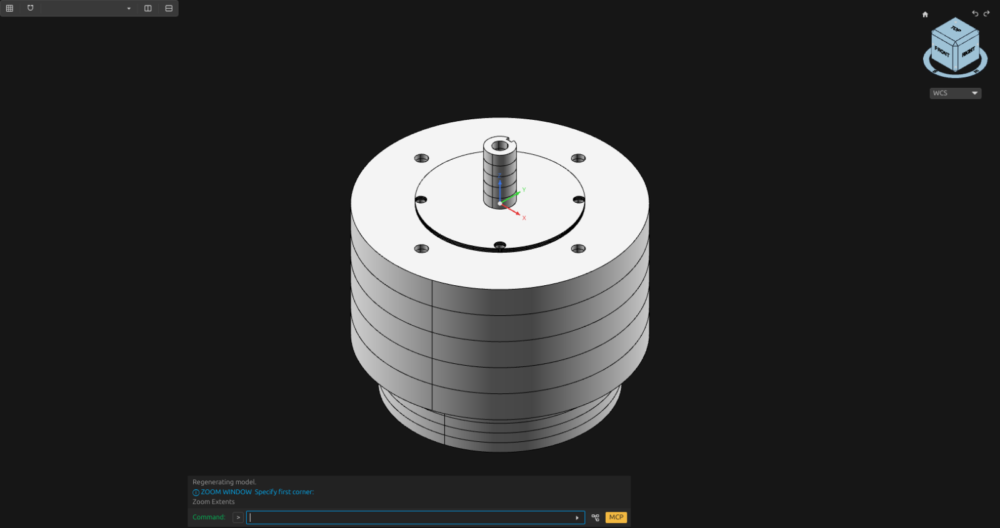
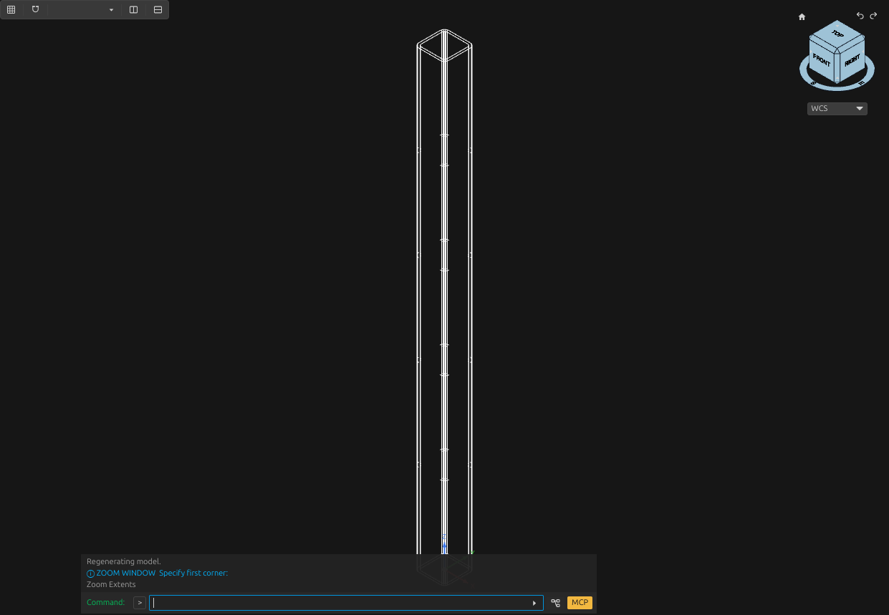

# Mechanical component examples

## Introduction

One of the reasons for the current project is thigns I've been creating and using this project is to automate as much as possible the building of a control remote 2 wheel tractor that I'd like to have for my small farm (that of course later I plan to make a robot out of it)

## Examples

The following examples are fully automated reconstructions from specs, the general pipeline for these component reconstructions is:

1. Read the exact product's drawings, specifications and pictures, and reuse any existing model.
2. List the dimensions needed for the body, holes, shafts, terminals and mounting points. Keep drawing dimensions and reconstructed details labelled separately.
3. Make the separate pieces in OpenCADStudio using profiles, extrusions, cuts and turned shapes.
4. Measure the bodies and interfaces against the source dimensions, correcting the affected geometry when a check fails.
5. Save the model, open it again and repeat the required checks. Capture views of the stored geometry.
6. Turn a repeated construction or check into a reusable helper, and test that helper with the recorded component data.

These existing OpenCADStudio captures show component geometry used to develop reusable construction and inspection procedures.

## Bearing unit

The SKF SY20TF model keeps the housing, bearing rings, seals, flingers, screws and grease fitting separately identifiable. The recorded saved-model result contains 62 passing native checks and a successful save and reopen check. [Bearing checker](../../scripts/pillow_block.py).

The recorded bearing iteration reopened the existing model, compared it with the SKF drawing, corrected the housing crown using two cuts, and checked the saved derivative.

## Battery module

The Nissan Leaf Gen2 module model represents the shells, mounting bores and terminal assemblies. The recorded saved-model result contains 29 passing native checks and a successful save and reopen check. [Battery checker](../../scripts/battery_module.py).
The battery iteration reopened the existing module, identified its separate shells and terminal parts, and checked their dimensions and positions against the source record.

## Motor interfaces

The Motenergy ME0907 model represents the source-dimensioned housing, pilot, blind mounting patterns and keyed shaft. This example exercises axial features, mounting-hole patterns and shaft interfaces. [Axial motor helper](../../scripts/axial_motor.py).

The motor build made the housing and locating pilot, cut the two blind mounting-hole patterns, added the keyed shaft, then checked the saved diameters, depths and positions.

## Frame member

The longitudinal rail represents proposed 40 × 40 × 3 mm square tube with a 600 mm cut length. The model uses a hollow rounded section. Its reusable procedure binds section dimensions and length to source-labelled inputs, then checks native and reopened geometry. [Tube helper](../../scripts/rounded_tube.py).

The rail build drew outer and inner rounded profiles, extruded the enclosed wall region into a hollow member, then checked the section and length after reopening.
