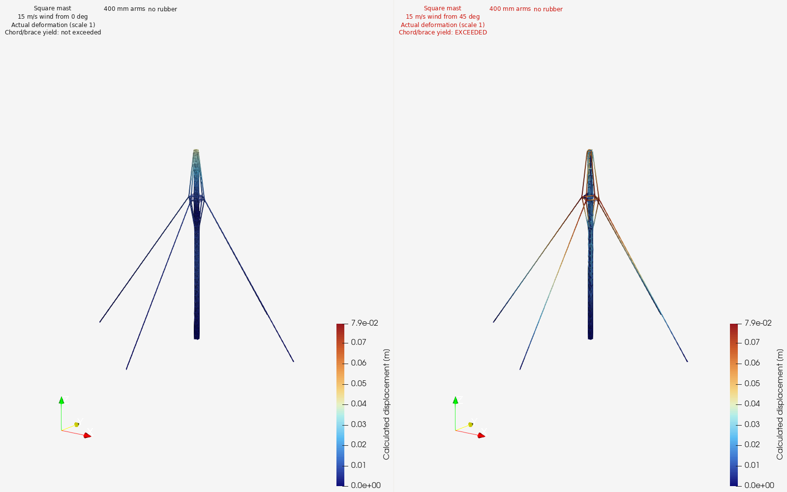
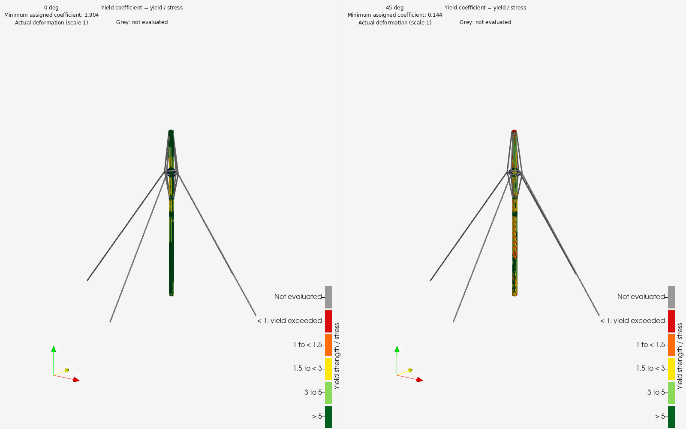

# Wind generator: models and mast physics

[Examples](README.md) · [Workflow](../workflow.md) · [Tools](../tools.md)

## Native 3D models

3. [Square mast DWG](files/wind-generator/square-mast.dwg): square lattice mast with 400 mm reinforcement arms. Its hash matches the native model identified in the retained simulation job.

## Mast simulation setup

1. **Solver:** Code_Aster 17.4.0. The retained sequence includes gravity equilibrium, cable-pretension calibration, wind equilibrium and saved-field extraction. [Executed case record](files/wind-generator/ideal-base-screening.md).
2. **Geometry:** upper square mast represented with beam members and DKTG plate elements; tension-only cable spans retain their attachment coordinates. The assembled base is idealized as rigid at the mast cut plane, fixing translation and rotation there. [CAD-to-simulation handoff](files/wind-generator/simulation-handoff.md).
3. **Loads:** 15 m/s wind (54 km/h), incoming directions 0° and 45°, gravity and retained head/aerodynamic loads. Load and resistance factors are both 1. [0° job](files/wind-generator/0deg-job.json) · [45° job](files/wind-generator/45deg-job.json).
4. **Material inputs:** steel E = 210 GPa and density = 7,850 kg/m³ are inherited assumed inputs. Chord yield = 235 MPa and brace yield = 275 MPa are registered manufacturer inputs. Installed cable pretension = 500 N is an inherited assumed input. [Input provenance](files/wind-generator/input-register.json).
5. **Frames:** CAD lengths use mm; solver geometry/results use m, N and Pa in the recorded global frame. Job records identify wind direction and application coordinates.

## Existing results

1. **Incoming wind 0°:** calculated mast-top horizontal displacement **0.04002 m**; chord combined stress **123.4 MPa** against an assigned **235 MPa** yield input; brace combined stress **100.0 MPa** against **275 MPa**. Chord/brace yield inputs are not exceeded in this elastic screening case.
2. **Incoming wind 45°:** calculated mast-top horizontal displacement **0.03316 m**; chord combined stress **813.4 MPa** against an assigned **235 MPa** yield input; brace combined stress **1908.8 MPa** against **275 MPa**. Chord/brace yield inputs are exceeded in this elastic screening case.

Values above are rounded from the unchanged [0° metrics](files/wind-generator/0deg-metrics.json) and [45° metrics](files/wind-generator/45deg-metrics.json). The 45° stress comparison records an elastic screening failure. This model evaluates upper-mast members and cable response with an idealized base; connection capacity and detailed plate surface-stress recovery have their own scope in the source record.

The displacement image uses actual deformation scale 1 and colours in metres.

The dimensionless colour coefficient is assigned yield strength divided by calculated stress. Values below 1 identify yield-input exceedance; grey elements are outside that comparison.

## CAD-to-simulation connection

1. Identify the native mast revision and hash in the [job](files/wind-generator/0deg-job.json).
2. Apply the explicit member, plate, cable, connection and support idealizations from the handoff and ideal-base records.
3. Bind source-classified loads/materials, then use the retained equilibrium and extraction sequence.
4. Compare the two saved wind cases using the same quantity definitions and display scales.

[Simulation preparation](../reference/operations.md#sim-01) · [Equilibrium and extraction](../reference/operations.md#sim-02) · [Result display](../reference/operations.md#sim-03) · [Asset provenance](../images/manifest.json)
