# 3D CAD Modeling

Reusable tools and agent instructions for creating, inspecting and modifying 3D models from descriptions, dimensions, drawings, photographs and existing geometry.

Each CAD modeling job saves a log and reusable scripts in your project. These stay local unless you choose to share an improvement through a pull request.

Most scripts use [OpenCADStudio](https://www.opencadstudio.com/) by default. To use another CAD application through its MCP server, the agent reads the application's documentation, checks which modeling commands the server provides, and tests the adapted procedure on a sample model. [How to adapt a CAD workflow](cad-mcp-translator.html).

The skills can also convert CAD files and scripts, including rendering an OpenSCAD model to STL and exporting a supported CadQuery model to STEP. [CAD format and script conversions](cad-format-translator.html).

I've tested conversions with STEP files, CadQuery scripts in Python, and a Blender model. You can watch the [Blender clevis build](#clevis-build-and-layer-isolation) below.

Geometry calculations and checks can take time.

This is ONGOING WORK. For now, this is the first pre-pre-pre-alpha release. I'll be updating it OFTEN. Please collaborate, copy it and share it; that is why the license is MIT.

## TLDR Install

```sh
npx skills add leomrocha/3d-cad-modeling
```

Choose the skills and AI agent in the installer. Then [ask your AI agent](#ask-your-ai-agent) to use the installed skills.

## License

[MIT](https://github.com/leomrocha/3d-cad-modeling/blob/master/LICENSE) for project code and documentation.
All external sources and assets have their own licenses. If I have accidentally left some things without the real check, please contact me and I'll be really pleased to take them out.

## Share the wins

Want to share a script or skill improvement from a modeling job? [Contribute an improvement](contributing.html).

## Introduction

If you want to go directly to the examples, check the [Examples](#examples).

I've been working for some time on CAD modeling. The last time I really touched CAD was OpenSCAD (cause I've done software for 20+ years now). The last time I really did something manually in CAD was AutoCAD 2000, some 25+ years ago. I'm too lazy now to learn to use another CAD application, so I decided I'd make AI agents model things for me. I draw on paper as I learnt 3 decades ago, then take pictures and show them to the model. I have my computer running while I sometimes manage things from my phone.

This adventure has not been without problems, blockers, frequent cursing and, of course, AI SLOP that I try to keep to a minimum. After so much work, learning and process improvement, I've started to consolidate all things into a single skills and scripts repository that takes lessons from all those "adventures".

This repo is now a test bed for my recursive self-improving skill (RSI - yes, this is an exaggeration) that I'm using for yet another project to make it better. This skill set is far from done, though I already use it and I'll keep improving it (it is already improving with each new model, and I have 100+ models queued for the automated workflow).

The idea is to share and see if somebody can use it, learn new things and make things faster and simpler.

I'll also share the things that I've been working on in other repositories when I consider they are ready enough, although here you'll get some example screenshots from those projects.

## Project

The project develops a common workflow for mechanical parts, assemblies, buildings and model handoffs to physics simulation.

The main pipeline for a 3D recreation from known things is:

1. Give the agent the part name, drawings, pictures and known measurements.
2. The agent checks whether a matching 3D model already exists.
3. It reads the dimensions and identifies the separate pieces, holes and mounting points.
4. It builds the missing shapes in CAD, or updates the existing model.
5. It measures the result, compares it with the references, saves it and opens it again to check the saved file.
6. It records the result and improves the reusable instructions or code for the next part.

And the main pipeline that I use for NEW things is:

1. I create some hand sketches and descriptions.
2. Send those to an agent.
3. Make the agent spawn a swarm of lightweight research agents to look online for similar things, ideas, concepts and so on.
4. Review those results.
5. Select a few things and ideas, drop others, rephrase, rewrite, restate and review the definitions, references and so on.
6. Get pissed off cause AI changed something without permission and without instruction.
7. Write down all findings and ideas, then commit the changes to Git to keep them.
8. Make AI use the skills for 3D modeling till it blocks (it cannot create things from nothing).
9. Review things and get pissed off again.
10. Iterate.

When I see things are ready enough, I send the automated 3D modeling pipeline to work.

## Repository

1. `docs/` — linked documentation, selected example copies and images.
2. `skills/` — agent task instructions.
3. `scripts/` and `tests/` — reusable helpers and their checks.
4. `research/` — method assessments, workflow definitions and sources.
5. `execution/` — recorded execution reports.

## Examples

### Tractor service-access assembly

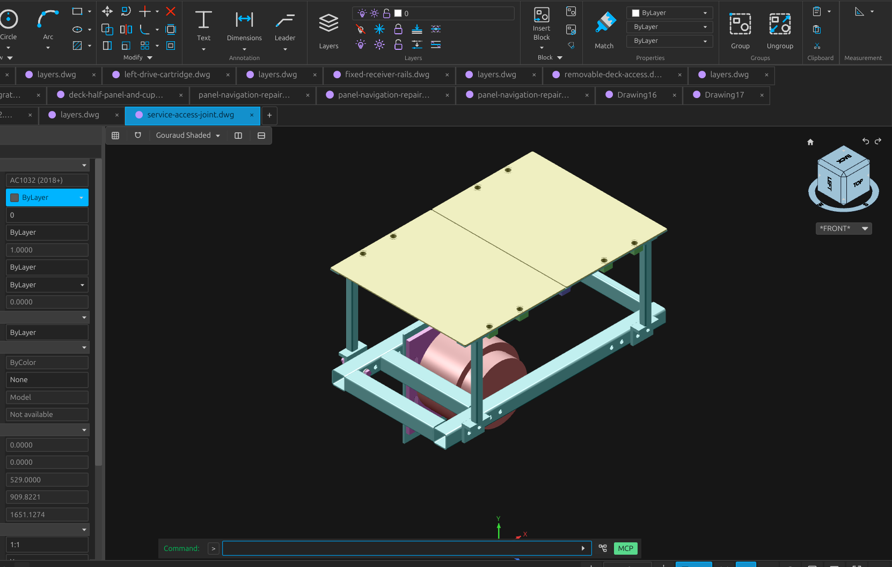

The blue deck in the drawing below is the removable group. Hide it and the fixed receiver rails remain visible above the motor. The lower views show the front interface and one clamp joint.

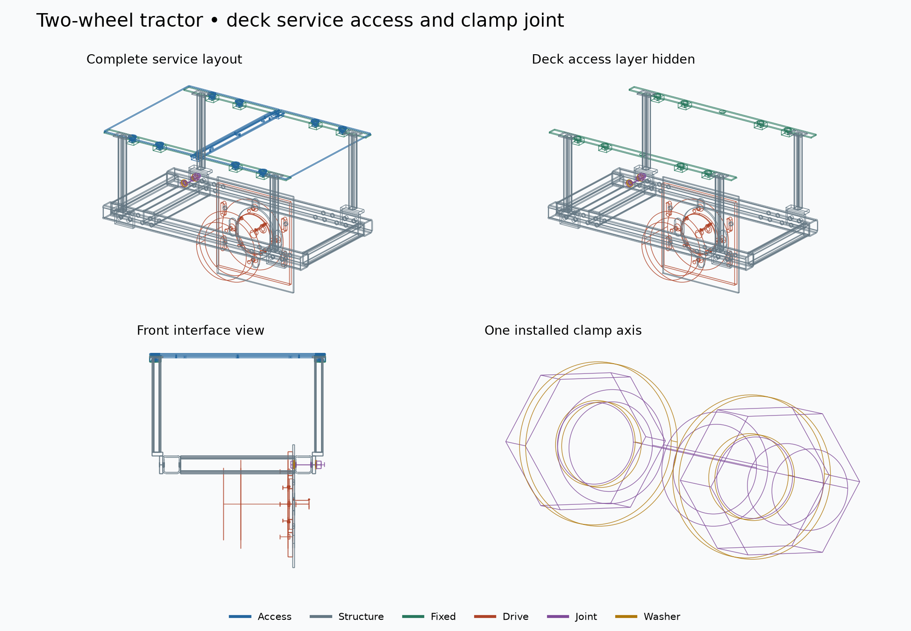

### Real-time OpenCADStudio builds

#### Assemble the two-wheel tractor service deck

Watch the frame, receiver rails, motor cartridge and clamp hardware come together in an empty millimetre drawing. The removable deck goes on last. The live terminal follows the commands through layer isolation, reopening the DWG and selecting the outboard washer.

<div class="build-player" markdown="1">
<video controls playsinline preload="none" width="960" style="max-width:100%;height:auto" aria-label="Assemble the two-wheel tractor service deck" poster="images/model-navigation/tractor-live-ocs.png"><source src="images/model-navigation/tractor-live-ocs.mp4" type="video/mp4"></video>

[Play the complete take (1:43)](images/model-navigation/tractor-live-ocs.mp4) · [0:04 Frame](images/model-navigation/tractor-live-ocs.mp4#t=4) · [0:24 M10 screw and first washer](images/model-navigation/tractor-live-ocs.mp4#t=24) · [0:57 Deck layer off](images/model-navigation/tractor-live-ocs.mp4#t=57) · [1:03 Receiver isolation](images/model-navigation/tractor-live-ocs.mp4#t=63) · [1:28 Fresh reopen and eleven-placement check](images/model-navigation/tractor-live-ocs.mp4#t=88)
</div>

#### Build a glass-roof veranda against the house

The existing house fixes the position of the veranda. With the ground floor at 0 mm and the terrace at −100 mm, OpenCADStudio builds the post shoes, oak frame, 17 rafters and roof covering. Watch the joint cuts, the glazing and timber layers, and the rafter selection after reopening.

<div class="build-player" markdown="1">
<video controls playsinline preload="none" width="960" style="max-width:100%;height:auto" aria-label="Build a glass-roof veranda against the house" poster="images/model-navigation/veranda-live-ocs.png"><source src="images/model-navigation/veranda-live-ocs.mp4" type="video/mp4"></video>

[Play the complete take (2:04)](images/model-navigation/veranda-live-ocs.mp4) · [0:05 Fabricate the post shoes](images/model-navigation/veranda-live-ocs.mp4#t=5) · [0:29 Seat the transverse members](images/model-navigation/veranda-live-ocs.mp4#t=29) · [1:08 Build seventeen rafters](images/model-navigation/veranda-live-ocs.mp4#t=68) · [1:39 Isolate timber frame](images/model-navigation/veranda-live-ocs.mp4#t=99) · [1:51 Close and reopen the native DWG](images/model-navigation/veranda-live-ocs.mp4#t=111)
</div>

<script defer src="assets/build-player.js"></script>

### Clevis build and layer isolation

| Complete joint | Fork hidden to inspect the pin and spacers |
| --- | --- |
| 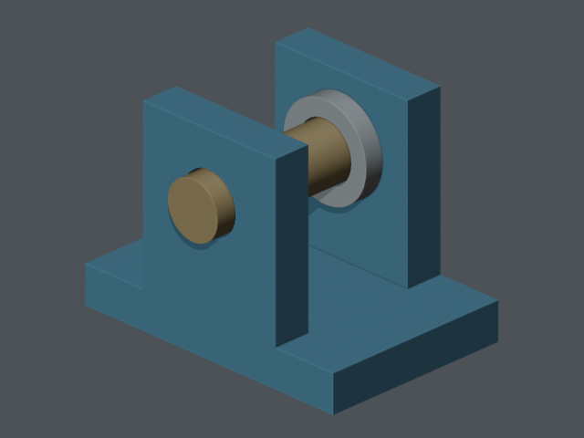 | 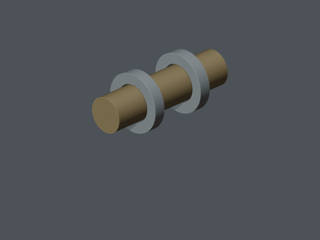 |

<video controls playsinline preload="none" style="max-width:100%;height:auto" width="640" aria-label="Eight stages of building a clevis in Blender" poster="images/model-navigation/clevis.png"><source src="images/model-navigation/clevis-build.mp4" type="video/mp4"></video>

[Watch the 16-second Blender build (MP4)](images/model-navigation/clevis-build.mp4). Eight captioned stages show the plate, lugs, bore, pin and spacers, followed by the isolated hardware.

### House modeling

The first thing I did at this complexity level with AI + drawings + pictures + a lot of iterations is a house model, you can see one example in the videos reproducing part of the build. The first iteration was a model house with ad-hoc  three.js visualization software. Now I've reproduced that model migrating it from the previous model into OCS. The output was finally done in [IFC](https://en.wikipedia.org/wiki/Industry_Foundation_Classes) and displayed in the browser.

[Watch the glass-roof veranda build](#build-a-glass-roof-veranda-against-the-house).

### Mast physics for a wind generator

I'm working on a wind generator idea, so I started to check how to model a mast support and see how it would behave for the particular geometry I'm trying to get on the top part. Many of the things I did there for the 3D modeling worked out, so I add them here as examples of what the earlier work allowed me to do (with a lot of interaction and effort).

A square mast model and recorded Code_Aster wind cases. [Mast model and simulation pictures](https://github.com/leomrocha/3d-cad-modeling/blob/master/docs/examples/mast.md).

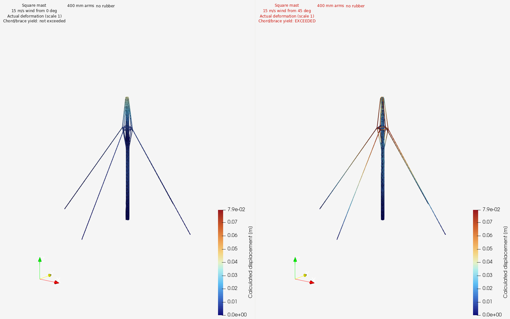

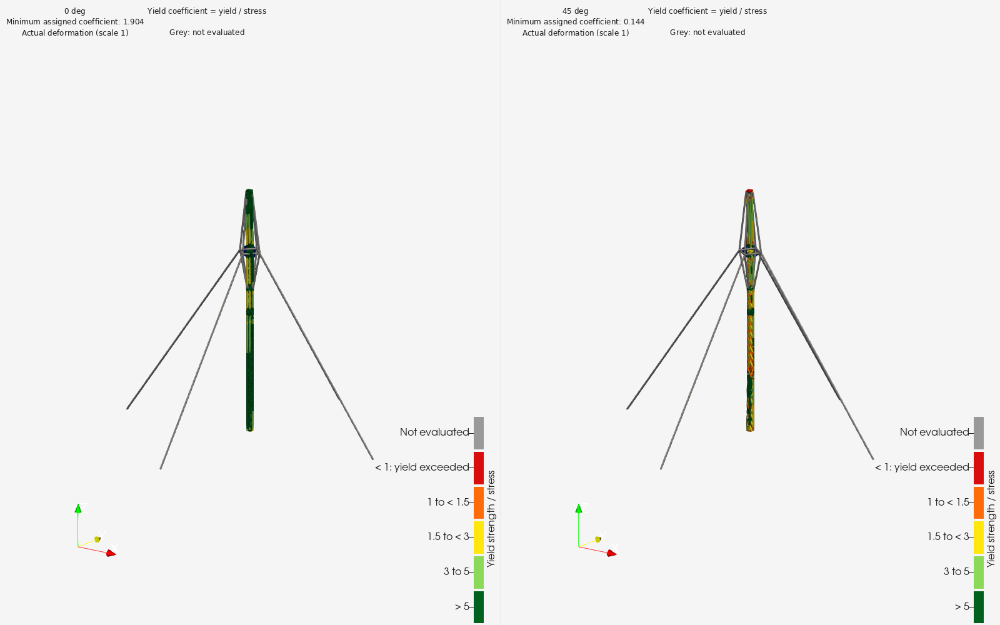

### Mechanical component models

Another current project is about making a remote-controlled 2-wheel tractor, but I do not really have time to work on it in detail, so I'm automating all that I can. This includes a (mostly) automated pipeline that gets available components from standards, pictures and manufacturer details that kind of fit in the base idea I have. I could write a lot, but the idea is to use this project as my 3D automation development test-base.

Selected motor, controller, bearing, battery and BMS examples show source-based construction, component boundaries and saved-model checks. [Mechanical component examples](https://github.com/leomrocha/3d-cad-modeling/blob/master/docs/examples/mechanical_components.md).

#### Bearing unit

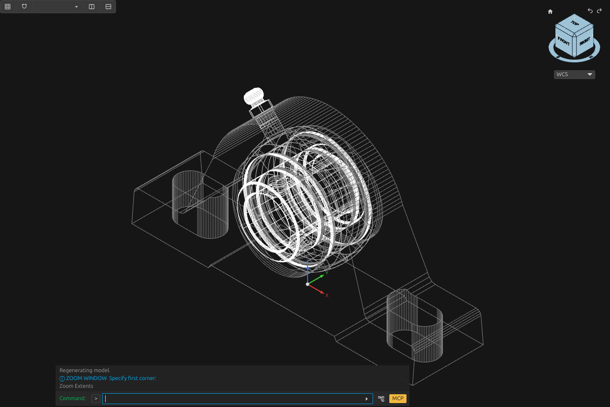

#### Battery module

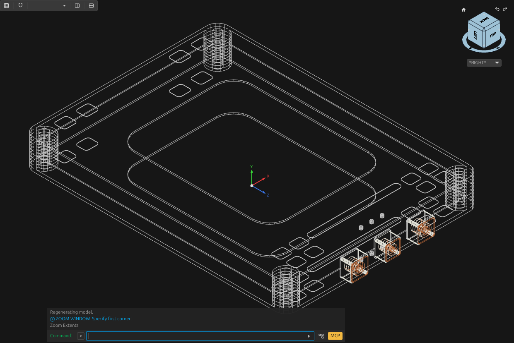

#### Motor interfaces

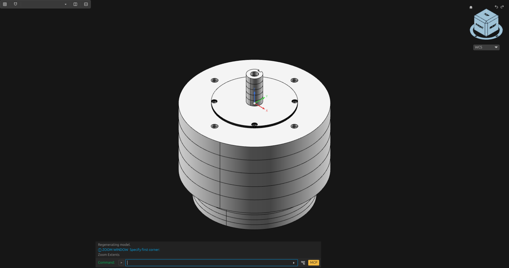

#### Sumitomo motor controller

Reconstructed housing, power terminals, connector pins, mounting holes and labels.

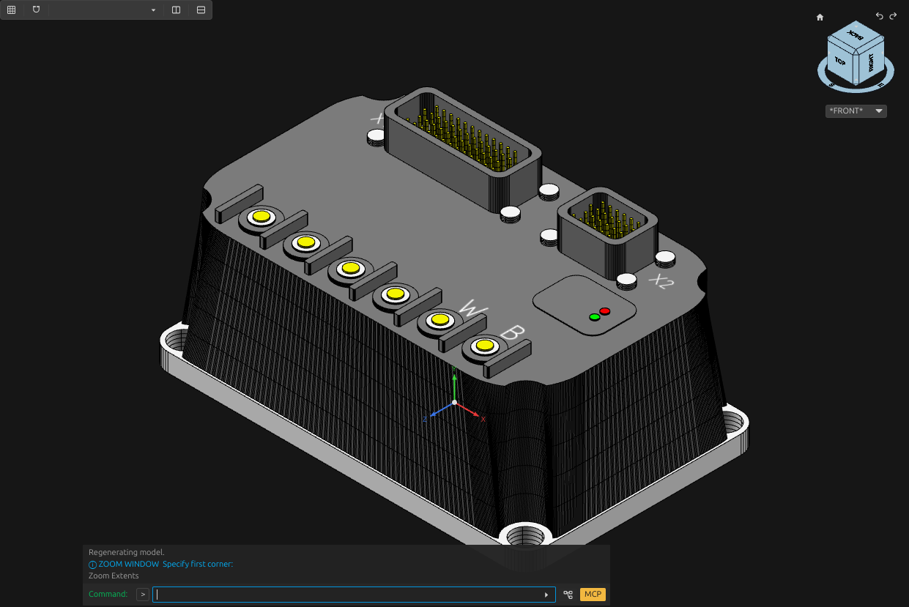

#### Victron Lynx Smart BMS

Manufacturer CAD assembly with corrected component placements, showing ventilation slots, connectors, fasteners and separate housing parts.

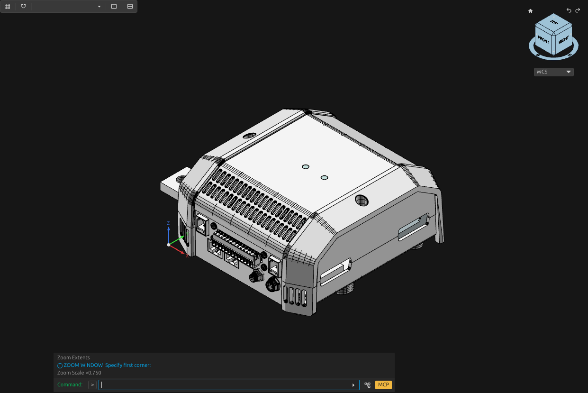

## Installing

### Install with npx

Run this from the project where you want the skills available:

```sh
npx skills add leomrocha/3d-cad-modeling
```

Choose the skills and target AI agent in the installer.

### Ask your AI agent

I would directly ASK the AI agent you are using to install this and make it available as skills and scripts.

For example:

> Install the skills from leomrocha/3d-cad-modeling for this project, set up their Python dependencies and run the package checks. Use the installed skills for my modeling requests.

#### Use the skills with your agent

1. Give the agent the drawing, pictures or dimensions and describe the model you need.
2. Ask it to read [cad-ocs-engineering](https://github.com/leomrocha/3d-cad-modeling/blob/master/skills/cad-ocs-engineering/SKILL.md) for a component job, [cad-drawing-inspection](https://github.com/leomrocha/3d-cad-modeling/blob/master/skills/cad-drawing-inspection/SKILL.md) for a DXF, or [cad-source-intake](https://github.com/leomrocha/3d-cad-modeling/blob/master/skills/cad-source-intake/SKILL.md) to record the inputs.
3. Specify the component project's input and output locations and the CAD session it should use.
4. Review the resulting model and the changes recorded for that iteration.

### Manual procedures

#### Prerequisites

1. Node.js **22.20 or later**, with npm and npx, for the [skills CLI](https://github.com/vercel-labs/skills).
2. Python **3.12** on Linux or macOS, including the `venv` module and pip, for the packaged helpers.
3. A running [OpenCADStudio](https://github.com/HakanSeven12/OpenCADStudio) session for CAD operations.

Check the command versions:

```sh
node --version
npm --version
npx --version
python3.12 --version
```

#### Install an individual skill into a project

Current skill names: `cad-ocs-engineering` (OCS modeling and component workflows), `cad-drawing-inspection` (DXF inspection), `cad-source-intake` (source capture and revisions), `cad-mcp-translator` (adapt a procedure to another CAD endpoint), and `cad-format-translator` (convert a model or editable program).

This example installs for Claude Code. Run it from the project directory where you want the skill available. Choose `cad-ocs-engineering`, `cad-drawing-inspection`, `cad-source-intake`, `cad-mcp-translator` or `cad-format-translator` as `SKILL_NAME`.

```sh
SKILL_NAME=cad-ocs-engineering
npx skills add leomrocha/3d-cad-modeling --skill "$SKILL_NAME" --agent claude-code --copy --yes
SKILL_ROOT="$PWD/.claude/skills/$SKILL_NAME"
test -f "$SKILL_ROOT/SKILL.md"
```

The project installation is available in that project's `.claude/skills/` directory. `--copy` creates an independent package copy. For a shared symlink installation targeting Claude Code and Codex together, replace `--agent claude-code --copy` with `--agent claude-code codex`. Claude Code's `SKILL_ROOT` path remains the same. The CLI uses copy mode for a single target agent. The [CLI command reference](https://github.com/vercel-labs/skills/blob/main/docs/commands.md) lists other supported agents and their installation options.

#### Alternative: install for all projects

For a user-wide Claude Code installation, use `--global` and its user directory. `CLAUDE_CONFIG_DIR`, when set, supplies Claude Code's configuration directory.

```sh
SKILL_NAME=cad-ocs-engineering
npx skills add leomrocha/3d-cad-modeling --skill "$SKILL_NAME" --agent claude-code --global --copy --yes
SKILL_ROOT="${CLAUDE_CONFIG_DIR:-$HOME/.claude}/skills/$SKILL_NAME"
test -f "$SKILL_ROOT/SKILL.md"
```

#### Alternative: install from a local checkout

Run this example from the 3D CAD Modeling checkout. It installs the current local skill for Claude Code in this checkout:

```sh
SKILL_NAME=cad-ocs-engineering
npx skills add . --skill "$SKILL_NAME" --agent claude-code --copy --yes
SKILL_ROOT="$PWD/.claude/skills/$SKILL_NAME"
test -f "$SKILL_ROOT/SKILL.md"
```

#### Set up and check the selected package

Continue in the same shell after one of the installation examples, retaining its `SKILL_NAME` and `SKILL_ROOT` assignments. Each package carries its scripts, instructions, dependency file and license. This creates a separate Python environment for the selected skill:

```sh
python3.12 -m venv "$HOME/.venvs/3d-cad-modeling/$SKILL_NAME"
. "$HOME/.venvs/3d-cad-modeling/$SKILL_NAME/bin/activate"
python -m pip install -r "$SKILL_ROOT/requirements.txt"
python "$SKILL_ROOT/scripts/package_check.py"
```

The checker prints JSON with `"result": "PASS"` after checking the packaged file hashes, imports and declared dependency versions. Source intake uses the Python standard library; drawing inspection and CAD use pinned dependencies. Repeat the installation and setup with another `SKILL_NAME` to install another package.

Give the agent your source files, job location and output paths. The `cad-ocs-engineering` package includes the OCS engineering workflow, component procedures, OCS control transport, geometry adapter and save/reopen helpers.

For `cad-ocs-engineering`, check a running OCS connection by replacing `SESSION` with its existing session ID:

```sh
python "$SKILL_ROOT/scripts/package_check.py" --session SESSION
```

The connection check reads OCS state and reports the observed document ID and revision. [Package contents and maintenance](https://github.com/leomrocha/3d-cad-modeling/blob/master/docs/skill-packaging.md).

#### Run a helper directly

With `SKILL_ROOT` pointing to `cad-drawing-inspection` or `cad-ocs-engineering`, inspect a DXF file named `drawing.dxf`:

```sh
python "$SKILL_ROOT/scripts/dxf_inspect.py" drawing.dxf --output drawing-inventory.json
```

Command-line options for the installed cad-ocs-engineering package:

```sh
python "$SKILL_ROOT/scripts/part_index.py" --help
python "$SKILL_ROOT/scripts/model_inventory.py" --help
python "$SKILL_ROOT/scripts/source_intake.py" --help
```

### Tools

To get a list of all skills and Python helpers, read the [tools page](https://github.com/leomrocha/3d-cad-modeling/blob/master/docs/tools.md). The [skill catalogue](https://github.com/leomrocha/3d-cad-modeling/blob/master/skills/README.md) links the component procedures for source interpretation, construction, assemblies and saved-result checks. The tools page also covers source-bound annular, hexagonal and toroidal geometry and spherical-seat profiles.

### DISCLAIMER

AI use:

* Code and skills are all written with AI. I instruct, reinstruct and review things, then I tell it to modify and update things. But as this is for AI use, I do not correct the phrasing for humans in the parts that are only dedicated to AI.
* The README and main HUMAN-targeted documentation files were sketched by me and written by AI. Then I drop almost everything cause I do not like it and rewrite things, then I send AI agents to fix some small things and details.
* For the AI documentation, I let AI do the writing and try not to get too angry about that cause they are instructions for AI, so ...
