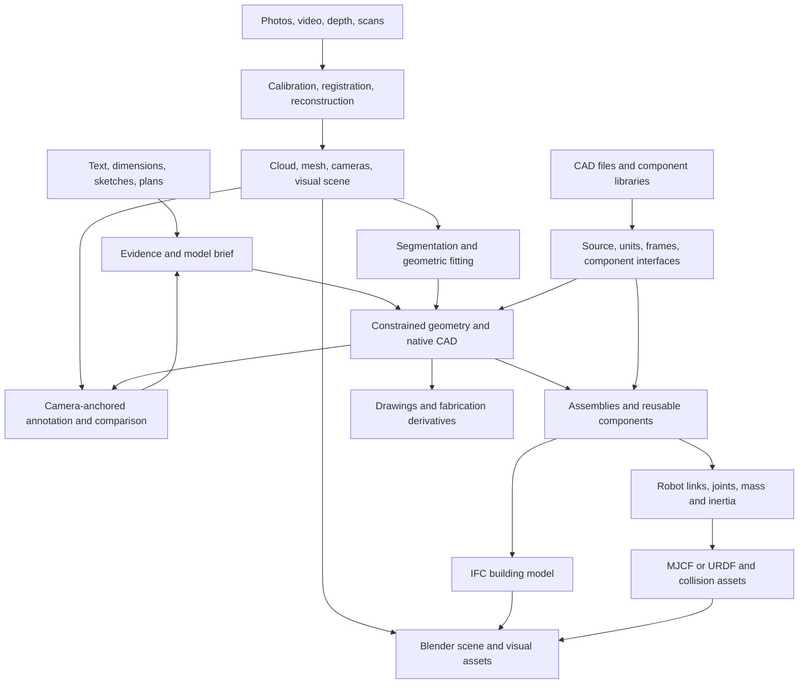

# Individual and combined 3D workflows

Research date: 12 November 2026. Status: research map and proposed compositions.

## Map structure

1. **Operations** describe one bounded transformation, with required inputs, output representations, tools, source links, prerequisites, preserved information, inferred/changed information and checks.
2. **Recipes** compose those operations for a concrete input combination and goal. The input list includes auxiliary evidence such as measurements or camera calibration. Every `inputs` type is required together; an `input_alternatives` group, when present, adds a choice of complete input sets. `input_choice_groups` requires a complete alternative from each independent choice group. A recipe's handoff conditions describe the relationships between those inputs.
3. **Candidate handoffs** connect an operation's output type to another operation's input type. Execution requires all the receiving operation's inputs and prerequisites. Units, frame mapping, scale, component identity and geometric validity are explicit handoff conditions.
4. **Iterations** preserve source revisions. An annotated view, revised measurement, model edit or reconstruction refinement creates a new revision linked to the preceding one and its evidence.
5. **Sources and ideas** have their own registers. Existing report claims retain their original evidence status. Workflow combinations carry proposal status until exercised with the documented checks.

## Research files

1. [CAD and 2D paths](cad-paths.md), [operation/recipe records](cad-paths.json).
2. [Reconstruction and mixed-input paths](reconstruction-paths.md), [operation/recipe records](reconstruction-paths.json).
3. [Architecture, robotics and component paths](domain-paths.md), [operation/recipe records](domain-paths.json).
4. [Combined workflows](combined-workflows.md), [cross-domain recipe records](combined-paths.json).
5. [Complete operation map](workflow-map.json), [registration checks](register-checks.json).
6. [Original source register](../sources/source-register.md), [structured source records](../sources/source-register.json).
7. [Ideas and research questions](../ideas-register.json).

8. [Composition rules](composition-rules.md) — sequences, branches, evidence merges, substitutions and revision loops.
9. [Operation catalogue](operation-catalogue.md) — each operation’s input/output summary and original sources.

## Representation and measurement contract

1. A source description or image carries evidence about the requested model. A model brief assigns units, part identities, dimensions, frames and interpretation labels to that evidence.
2. A constrained sketch and native/procedural model retain editable construction intent. A solid interchange file preserves the actual geometry and metadata written by its exporter. Record feature history in the native model or generator.
3. A calibrated point cloud or reconstruction carries camera/sensor and registration evidence. Independent measurements assess dimensional residuals in the relevant region.
4. A polygon mesh carries sampled surfaces. Visual mesh, fitted surface, collision mesh and fabrication mesh have different roles and checks. Track the recipe that produces each derivative.
5. Gaussian and NeRF scenes carry view-dependent scene representations and camera information. Surface extraction requires a method that supports that representation, with its own geometry checks.
6. IFC retains building entities and relationships. A robot model retains bodies, joints, frames and inertial properties. The domain adapters record their relation to the source components.

## Workflow families



The diagram shows workflow families. The operation and recipe records provide each actual tool, prerequisite and evidence link. Paths can branch to combine measurements, reconstruction and existing components, and can loop through a new revision after inspection.

## Rebuild and check

Run from the repository root:

```sh
python3 research/tools/build_workflow_register.py --date 2026-11-12
```

This rebuilds source/idea registers and the combined operation map from the retained reports and domain records. It checks operation references, source registration and declared type availability through each recipe. Those checks concern documentation consistency. Each workflow record also states the numerical and importer checks for its eventual execution.

## Detailed procedures and effort classification

[Input requirements, documented software APIs and all 38 ranked workflows](/home/leo/projects/3dmodeling/research/workflows/details/README.md). The manual-effort and computing tables use independent ordinal scales and state each route’s comparison conditions.
