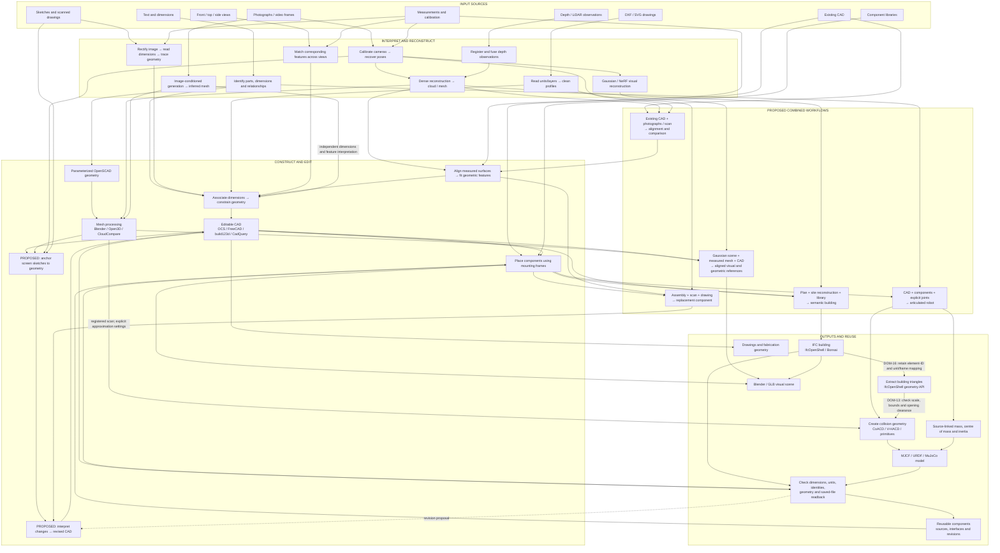

# Reconstruction workflow paths

Research date: 2026-11-12. This map extends, and does not replace, [the reconstruction assessment](../reconstruction.md) or [the implementation plan](../implementation-plan.md). Workflow combinations in this document are proposed compositions; source links establish documented operations, not a locally executed pipeline. Reused claims from `reconstruction.md` are marked `existing_report_registered` in the source register. New sources were inspected through primary documentation; no originals were downloaded.

## Representation boundaries

- **Camera solution:** camera intrinsics, distortion, poses and sparse scene structure. Calibrated target coordinates can establish a world frame; a monocular photo set still needs measured control to set scale.
- **Registered metric reference:** aligned depth/LiDAR/photo geometry with units, transforms, sensor or control provenance, and residuals. Registration output is a transform estimate; fitness/RMSE alone do not establish accuracy.
- **Surface mesh:** triangulated visible or fused surface. Its spacing and vertex count do not state measurement uncertainty. Use separate checks against withheld dimensions and source clouds.
- **View-synthesis scene:** NeRF radiance field or Gaussian scene fitted to captured views. It supports rendered novel views; scene scale depends on its cameras/data. A Gaussian splat file is not an analytic surface.
- **Feature interpretation:** fitted planes, axes, cylinders, circles or other geometric hypotheses extracted from sampled surfaces. Record candidate parameters and fit residuals; a geometric fit is not automatically the intended CAD feature.
- **Editable CAD:** constrained sketches, analytic faces/solids, component identities and assembly relations. Rebuild from accepted dimensions and labeled inferences; keep source scan and transform as comparison evidence.

## Mermaid workflow graph

This graph maps generic input, reconstruction, CAD, assembly and output operations. Combined routes and revision loops carry proposal status. Source-backed operation descriptions and local execution results retain their separate evidence labels in the linked records.



### Graph procedures and source references

Each operation record contains its tool/API, required inputs, prerequisites, preserved information, changed or inferred information, checks and original source URLs. The [source register](../sources/source-register.md) provides the source summaries and evidence status.

| Graph operations | Supporting procedures and records | Handoff conditions and checks |
| --- | --- | --- |
| Text, drawing interpretation, constraints, CAD and CSG | [CAD procedures](cad-paths.md); [CAD operation records](cad-paths.json), including CAD-01 through CAD-10 and CAD-15 | Preserve source dimensions, units, drawing planes and feature associations; check profiles, solid/mesh representation and saved-file readback. |
| Cameras, dense surfaces, depth fusion, inferred meshes and view synthesis | [Reconstruction operation records](reconstruction-paths.json), REC-01 through REC-06 and REC-17 through REC-20 | Retain camera/sensor calibration, poses, scale controls and frame transforms; compare independent measurements and regional geometry. |
| Feature fitting, CAD alignment, annotation and revision | [Reconstruction procedures](reconstruction-paths.md#operation-graph); [operation records](reconstruction-paths.json), REC-07 through REC-16 | Name source/target geometry and revisions; retain fit residuals, source point indices and calculated annotation anchors; define sketch intent and dimensions before CAD changes. |
| Assembly, semantic buildings, robots and component reuse | [Domain procedures](domain-paths.md); [domain operation records](domain-paths.json) | Preserve component identities and mounting frames; author building relationships or robot joints explicitly; retain source-linked physical properties. |
| IFC → triangles → collision geometry | [Domain operation records](domain-paths.json), DOM-16 IFC triangle extraction and DOM-13 collision generation | Use IfcOpenShell extraction and CoACD/V-HACD or explicit primitives; retain IFC element mapping and unit/frame conversion; check bounds, approximation settings, openings and contact geometry. |
| Combined input branches and cross-domain outputs | [Combined workflow descriptions](combined-workflows.md); [recipe records](combined-paths.json), MIX-R01 through MIX-R10 | These are proposed compositions. Each recipe records the contributing artifacts, their roles, source URLs and handoff conditions. |

## Operation graph

Operation identifiers and complete records are in `reconstruction-paths.json`. Important transitions:

| Route | Operation IDs | Result and limiting handoff |
|---|---|---|
| Lens calibration and measured pose | REC-01 → REC-02 | OpenCV calibration target → intrinsics/distortion → `solvePnP` world-to-camera transform and reprojection residual. Requires known 3D target coordinates and matching 2D image points. |
| Overlapping photos/video to photogrammetry | REC-04 → REC-03 → REC-17 | Video frames become a photo set; SfM estimates camera poses and sparse points; the separate MVS stage produces dense cloud and mesh. Global scale remains arbitrary until measured controls or calibrated metric input anchor it. |
| Calibrated RGB-D fusion | REC-05 → REC-06 | Open3D RGB-D frames + intrinsics + poses → point cloud/TSDF mesh. Color/depth registration and pose units must match; voxel length is a discretization parameter, not accuracy. |
| Point clouds to registered scene | REC-07 → REC-08 | FPFH/RANSAC initial alignment → ICP refinement with fitness, inlier RMSE and transform → fused or compared clouds. Use independent controls for accuracy. |
| Cloud segmentation and geometric evidence | REC-09 | Open3D RANSAC planes/DBSCAN clusters; retain point indices and residuals. Cylinder/axis fitting is a proposed downstream fit whose method and parameters must be named per feature. |
| Learned multi-view depth | REC-10 | Depth Anything 3 / DA3 Streaming estimates depth, poses, confidence and point geometry. Treat metric-model scale as model evidence and check against controls. |
| NeRF/splat view synthesis | REC-19 or REC-20 | Train a Gaussian scene (REC-19) or NeRF (REC-20) as separate native outputs. Gaussian PLY export is supported; current Splatfacto docs conflict on mesh/point-cloud extraction, so dense geometry uses an independent stage. |
| CAD to image registration | REC-12 → REC-02 | Known CAD fiducials/features and calibrated camera observations → PnP pose; optional coarse-to-fine scan/CAD point-cloud registration. Keep CAD units and camera frame explicit. |
| 3D-anchored annotation | REC-13 | Screen sketch ray-tested against a mesh/CAD surface yields world-space anchors; preserve camera intrinsics/pose and source element IDs. A constrained sketch requires a separate choice of plane, constraints and feature meaning. |
| Surface-to-CAD remodeling | REC-09 → REC-14 | Segment and fit evidence, then create constrained features in OCS/selected parametric CAD, with dimensions linked to direct, drawing, control-fit or inferred status. Keep triangle-derived surfaces separate. |
| Scan + drawing reconciliation | REC-09 → REC-15 → REC-14 | Compare scan surfaces with drawing datums and dimensions, then create CAD; reserve dimensions for validation and attribute discrepancies to their source. |
| Edit/compare loop | REC-16 | Versioned CAD edit → project/check against same scan and controls → report regional distance and dimensional deltas; preserve prior source and comparison revision. |

### Camera and coordinate conventions

OpenCV PnP returns object/world-to-camera rotation and translation: camera X points right, Y down, Z forward. Invert and store the matrix when a downstream scene expects camera-to-world. Use explicit right-handedness, length units, origin, axis order and transform direction in each adapter record. Open3D RGB-D integration consumes a camera trajectory and applies per-frame poses; its example inverts pose before integration. Do not transfer a pose matrix between COLMAP/OpenCV, Open3D, Blender and CAD without checking conventions.

### Splat and NeRF export constraint

Nerfstudio documentation describes `ns-export tsdf` as working for all models and `ns-export poisson` as requiring predicted normals. Its Splatfacto page separately says mesh/pointcloud export is currently unsupported while documenting Gaussian-splat export. The docs may describe different versions or API surfaces. The safe plan is to preserve the trained splat as `gaussian-scene`, use COLMAP/MVS or calibrated depth for a measurable mesh, and test `ns-export tsdf` with the exact Splatfacto configuration before adding that path to a supported workflow. Poisson export requires normals, such as Nerfacto `predict-normals=True`; do not infer its availability for Splatfacto.

## Recipes and handoffs

Recipes `REC-R01`–`REC-R10` in JSON map separate operations to concrete combinations. Core proposed combinations:

1. **Photo set + measured dimensions:** calibrate images; solve poses; use measured controls as the world frame/scale; run MVS; validate against withheld lengths; rebuild parametric CAD. Use measured values as constraints and report reconstruction residuals independently.
2. **Video + RGB-D/LiDAR:** extract sharp frames; register depth/laser scans into the camera solution with target-based or feature-based initialization; use ICP only for refinement; compare loops and held-out baselines. RGB and depth fusion needs known extrinsics/intrinsics or a calibrated inter-sensor transform.
3. **Existing CAD + photos:** identify measured CAD corners/targets in images; solvePnP against known 3D coordinates; project CAD edges back into held-out views; optionally align scan cloud to tessellated CAD with global registration plus ICP. CAD rasterization supplies the projected hypothesis for comparison.
4. **Scan + drawing:** register scan to drawing datums using common planes/holes/targets; establish units and transform; use drawing dimensions to constrain feature sketches; check residuals by region and against dimensions withheld from fitting.
5. **Photos + learned depth + splat:** DA3 provides estimated camera/depth/point/splat outputs; compare its metric scale and geometry to measured controls and conventional SfM/MVS. Preserve both estimate families and their confidence/fit residuals.
6. **Splat + mesh + CAD:** train/view splat for image-consistent context; generate a separate mesh from dense stereo or validated TSDF; align the mesh to controls; remodel only selected surfaces into CAD. Keep the splat, mesh and CAD as linked but different representations.
7. **Sketch over 3D:** project the 2D stroke through the active calibrated camera, ray-test against selected scene surfaces, store world-space anchors plus hit component/face/triangle and camera transform; build a constrained CAD sketch from anchors only after plane/axis/dimension constraints are explicit.
8. **Iterative edit and compare:** preserve immutable source scan and measurement set; make a revisioned CAD edit; compute distances, sections and dimensions against the same registration; show per-region residual maps and identify edited features.
9. **Photogrammetric scene to visual delivery:** solve camera poses and sparse cloud; train a selected NeRF or Gaussian scene from the same images; retain original photo set and pose bundle. Keep view synthesis separate from dimensional CAD evidence.
10. **Reference photo to object proposal:** REC-18 generates a learned image-to-3D mesh proxy. Add measured dimensions or a drawing before REC-14 creates CAD; label unseen geometry as inferred.

## Registered open questions and proposals

- **Proposal:** use Open3D global registration (FPFH/RANSAC) to initialize scan/CAD or scan/scan, then ICP; tune correspondence threshold in model units and report fitness plus inlier RMSE. Check withheld controls because the optimizer can converge to a low-residual wrong alignment on repeated or symmetric geometry.
- **Proposal:** use Open3D RANSAC plane extraction and DBSCAN to isolate candidate building planes or part regions; preserve point indices and parameter residuals. For analytic cylinders, circles, threads and fillets, compare feature-specific fitters rather than treating all parts as planes.
- **Proposal:** use OpenCV camera calibration and `solvePnP` for dimensioned targets and existing-CAD-to-photo alignment. Record distortion model, calibration image set, coordinate transform direction and pixel reprojection residuals.
- **Proposal:** annotate geometry by casting camera rays from 2D strokes to a named mesh/cloud/solid, then save anchor coordinates in a declared world frame plus component ID and hit element. Decide whether annotation means a surface trace, projected curve or a planar CAD sketch before creating geometry.
- **Research question:** determine which current Nerfstudio releases support TSDF export from Splatfacto, the expected depth output and a stable API; compare mesh accuracy to independent controls. Existing docs conflict.
- **Research question:** choose a stable exchange record for transforms and anchors across COLMAP/OpenCV, Open3D, Blender and OCS; test matrix convention, units, axis handedness and precision with a small checked fixture.
- **Proposal:** keep semantic feature decisions and CAD dimensional constraints in the OCS workflow. Geometry extracted from Open3D remains candidate evidence until OCS constraints and readback checks pass.

## Source record

`reconstruction-paths.json` provides operation- and recipe-level source references. `../sources/round-02/reconstruction-sources.json` stores the source titles, original URLs, summaries, access dates and evidence statuses. No source file was downloaded as an original in this batch.

## Documented third-party tool commands

These commands and parameter mappings describe documented software procedures. Evidence status: source-supported workflow proposals.


### OpenCV calibration parameters → COLMAP database → OpenMVS

OpenCV `calibrateCamera` produces `K`, distortion coefficients `[k1,k2,p1,p2,k3]`, image dimensions and pixel residuals. COLMAP uses a corner-based image-pixel convention whose principal point is `+0.5 px` relative to OpenCV. For a matching camera model, map `K` and distortion to COLMAP `FULL_OPENCV` parameters:

```text
fx, fy, cx+0.5, cy+0.5, k1, k2, p1, p2, k3, 0, 0, 0
```

The zero values fill COLMAP `k4,k5,k6`; this adapter assumes OpenCV's five-coefficient calibration output and a compatible pinhole lens. Pass the resulting comma-separated values to `--ImageReader.camera_params` during feature extraction. Use `--ImageReader.single_camera 1` only when every image has the same physical camera, crop, resolution and focus state. Read the camera back with `pycolmap.Database.read_camera`, verify model/dimensions/parameter order, and select whether bundle adjustment may refine the values. COLMAP refines intrinsics by default. Do not edit its binary SQLite parameter blob manually. Sources: [COLMAP known-intrinsics FAQ](https://colmap.github.io/faq.html), [camera models](https://colmap.github.io/cameras.html).

```text
colmap feature_extractor --database_path <database.db> --image_path <images> \
  --ImageReader.single_camera 1 --ImageReader.camera_model FULL_OPENCV \
  --ImageReader.camera_params '<adapter-produced-12-values>'
colmap exhaustive_matcher --database_path <database.db>
colmap mapper --database_path <database.db> --image_path <images> --output_path <sparse>
colmap image_undistorter --image_path <images> --input_path <sparse/0> \
  --output_path <dense> --output_type COLMAP
InterfaceCOLMAP -i <dense> -o <scene.mvs> --image-folder <dense/images>
DensifyPointCloud <scene.mvs>
ReconstructMesh <scene_dense.mvs>
```

The COLMAP/OpenMVS handoff is `image_undistorter` → `InterfaceCOLMAP`; the importer consumes undistorted images, sparse camera poses and sparse points and writes an MVS scene. OpenMVG's `openMVG_main_openMVG2openMVS` is a separate exporter route documented by OpenMVS. These paths are not interchangeable adapters. Sources: [COLMAP CLI](https://colmap.github.io/cli.html), [OpenMVS usage](https://github.com/cdcseacave/openMVS/blob/develop/docs/wiki/Usage.md).

### Other documented CLI routes

```text
# AliceVision Meshroom photogrammetry graph
meshroom_batch --input <images-folder> --output <output-folder>

# Nerfstudio image set → Gaussian scene; geometry remains separate
ns-process-data images --data <images-folder> --output-dir <processed-data>
ns-train splatfacto --data <processed-data>

# TripoSR single-image mesh proxy
python run.py <single-image> --output-dir <output-folder>
```

Meshroom saves graph intermediates and can reuse cached nodes. Nerfstudio uses COLMAP and FFmpeg in the image processing route. TripoSR's own README says its command writes a reconstructed model and reports about 6 GB VRAM for one image. These are documented invocation contracts, not commands executed in this batch. Sources: [Meshroom batch usage](https://github.com/alicevision/Meshroom/blob/develop/INSTALL.md), [Nerfstudio custom data](https://docs.nerf.studio/quickstart/custom_dataset.html), [Nerfstudio Splatfacto](https://docs.nerf.studio/nerfology/methods/splat.html), [TripoSR README](https://github.com/VAST-AI-Research/TripoSR/blob/main/README.md).
